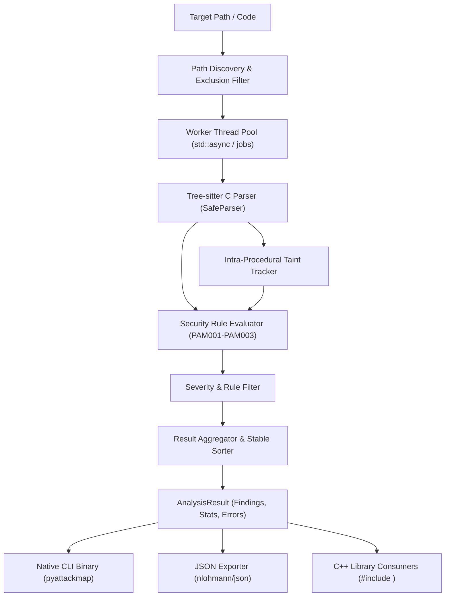

# PyAttackMap Native C++20 Architecture & Design Specification

## System Overview

PyAttackMap is architected as an offline, zero-network, intra-procedural static analysis engine designed around Tree-sitter's high-speed C parser runtime and native C++20.

## Architectural Layers

1. **Path Resolution & Filtering (`pyattackmap::Analyzer::discover_python_files`)**:
   - Discovers `.py` files recursively using `std::filesystem::recursive_directory_iterator`.
   - Prunes excluded subtrees (`.git`, `.venv`, `__pycache__`) before descending, avoiding unnecessary I/O.
   - Evaluates wildcard exclusion patterns via an iterative $O(N)$ glob matcher.

2. **Parsing & AST Construction (`pyattackmap::SafeParser`, `pyattackmap::ParsedSource`)**:
   - Parses target Python source into a Concrete Syntax Tree using `tree-sitter` and `tree-sitter-python`.
   - Never evaluates or executes target code.
   - Wraps raw C pointers in RAII structures (`std::shared_ptr<TSTree, TSTreeDeleter>`, `ScopedTSParser`).
   - Detects syntax errors using `ts_node_has_error()` and pinpoints coordinates via BFS, reporting structured `ParseException` diagnostics without halting batch processing.

3. **Data-Flow & Taint Engine (`pyattackmap::IntraProceduralTaintTracker`)**:
   - Performs lexical intra-procedural taint analysis across top-level statements and function/method bodies.
   - Tracks def-use propagation across assignments, variable reassignments, binary concatenation (`+`), percent-formatting (`%`), and f-strings.
   - Recognizes sanitizers (`shlex.quote`, numerical casts) to clear taint states.
   - Assembles immutable `DataFlowGraph` objects featuring discrete `Source`, `Propagation`, and `Sink` nodes with source line and column coordinates, exportable to Mermaid and JSON.

4. **Security Rules Engine (`pyattackmap::Rule`, `pyattackmap::RuleRegistry`)**:
   - Modular, polymorphic `Rule` hierarchy registered with `RuleRegistry::default_registry()`.
   - Built-in rules:
     - `PAM001`: SQL Injection (`CWE-89`).
     - `PAM002`: Command Injection (`CWE-78`).
     - `PAM003`: Unsafe Deserialization (`CWE-502`).

5. **Reporting & Presentation (`pyattackmap::TextReporter`, `pyattackmap::JsonReporter`, `pyattackmap::cli`)**:
   - Terminal human-readable text reporter with severity color tags and code snippets.
   - Deterministic JSON serializer powered by `nlohmann/json`.
   - Standalone native CLI binary `pyattackmap` adhering to standard exit codes (0 = clean, 1 = findings detected, 2 = usage error, 3 = execution error).
